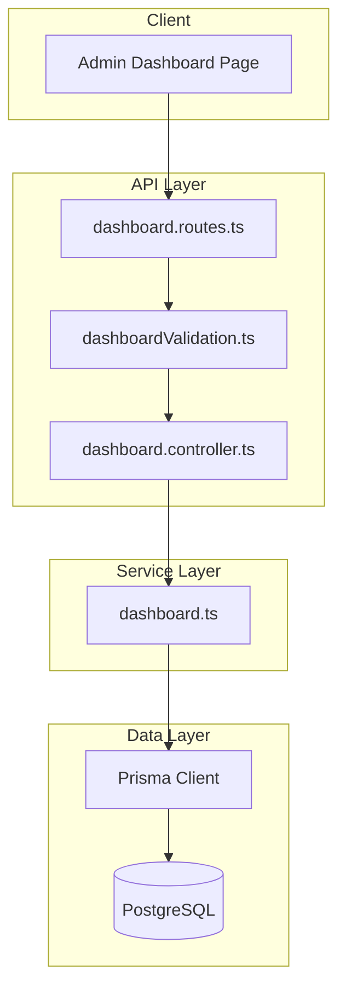

# Design Document: Dashboard Management API

## Overview

The Dashboard Management API provides aggregated statistics and analytics data for the admin dashboard. It consolidates data from users, subscriptions, inquiries, and calculates revenue metrics to power dashboard visualizations. The API follows the existing Express.js patterns established in the codebase with controller-service architecture, Joi validation, and Prisma ORM for database access.

## Architecture



The API follows the established patterns:

- Routes define endpoints and apply middleware
- Validation schemas validate request parameters using Joi
- Controllers handle HTTP request/response logic
- Services contain business logic and database operations

## Components and Interfaces

### Routes (server/routes/dashboard.routes.ts)

```typescript
// GET /api/admin/dashboard/stats - Get aggregated statistics
// GET /api/admin/dashboard/user-growth - Get user growth time-series
// GET /api/admin/dashboard/plan-popularity - Get subscription plan popularity
// GET /api/admin/dashboard/inquiry-trends - Get inquiry trend data
// GET /api/admin/dashboard - Get combined dashboard data
```

### Controller (server/controllers/dashboard.controller.ts)

```typescript
export class DashboardController {
  static async getStats(req: Request, res: Response): Promise<void>;
  static async getUserGrowth(req: Request, res: Response): Promise<void>;
  static async getPlanPopularity(req: Request, res: Response): Promise<void>;
  static async getInquiryTrends(req: Request, res: Response): Promise<void>;
  static async getDashboardData(req: Request, res: Response): Promise<void>;
}
```

### Service (server/services/dashboard.ts)

```typescript
export class DashboardService {
  static async getStats(): Promise<DashboardStats>;
  static async getUserGrowth(timeRange?: TimeRange): Promise<TimeSeriesData>;
  static async getPlanPopularity(): Promise<PlanPopularityData[]>;
  static async getInquiryTrends(timeRange?: TimeRange): Promise<TimeSeriesData>;
  static async getDashboardData(timeRange?: TimeRange): Promise<CombinedDashboardData>;
}
```

### Validation (server/validation/dashboardValidation.ts)

```typescript
export const timeRangeSchema: Joi.ObjectSchema;
export const dashboardQuerySchema: Joi.ObjectSchema;
```

## Data Models

### DashboardStats

```typescript
interface DashboardStats {
  totalRevenue: number;
  revenueChange: number;
  revenueIncreased: boolean;
  totalUsers: number;
  userChange: number;
  userIncreased: boolean;
  activeUsers: number;
  activeChange: number;
  activeIncreased: boolean;
}
```

### TimeSeriesData

```typescript
interface TimeSeriesData {
  labels: string[]; // e.g., ["Jan", "Feb", "Mar", ...]
  data: number[]; // e.g., [100, 150, 200, ...]
  period: string; // "monthly" | "weekly" | "daily"
}
```

### PlanPopularityData

```typescript
interface PlanPopularityData {
  planId: string;
  planName: string;
  subscriberCount: number;
  percentage: number; // Percentage of total subscribers
}
```

### CombinedDashboardData

```typescript
interface CombinedDashboardData {
  stats: DashboardStats | null;
  userGrowth: TimeSeriesData | null;
  planPopularity: PlanPopularityData[] | null;
  inquiryTrends: TimeSeriesData | null;
  errors?: {
    stats?: string;
    userGrowth?: string;
    planPopularity?: string;
    inquiryTrends?: string;
  };
}
```

### TimeRange

```typescript
interface TimeRange {
  startDate: Date;
  endDate: Date;
}
```

## Correctness Properties

_A property is a characteristic or behavior that should hold true across all valid executions of a system-essentially, a formal statement about what the system should do. Properties serve as the bridge between human-readable specifications and machine-verifiable correctness guarantees._

### Property 1: Statistics Response Completeness

_For any_ database state with users and subscription plans, the statistics endpoint SHALL return a response containing totalRevenue, totalUsers, activeUsers, and their respective change percentages and direction indicators. **Validates: Requirements 1.1, 1.3, 1.4**

### Property 2: Revenue Calculation Correctness

_For any_ set of subscription plans with prices and subscriber counts, the calculated totalRevenue SHALL equal the sum of (plan.price × plan.subscriberCount) for all plans. **Validates: Requirements 1.2**

### Property 3: User Growth Time-Series Structure

_For any_ set of users with creation dates, the user growth endpoint SHALL return matching arrays of labels and data where each label corresponds to a time period and each data value represents the user count for that period. **Validates: Requirements 2.1, 2.4**

### Property 4: User Growth Date Filtering

_For any_ time range filter with valid start and end dates, the user growth data SHALL only include users created within that date range (inclusive). **Validates: Requirements 2.2**

### Property 5: Plan Popularity Aggregation

_For any_ set of subscription plans and user subscriptions, the plan popularity endpoint SHALL return each plan with its name and the exact count of users subscribed to that plan. **Validates: Requirements 3.1, 3.2**

### Property 6: Plan Popularity Ordering

_For any_ plan popularity response with multiple plans, the plans SHALL be ordered by subscriberCount in descending order (highest first). **Validates: Requirements 3.3**

### Property 7: Inquiry Trends Time-Series Structure

_For any_ set of inquiries with creation dates, the inquiry trends endpoint SHALL return matching arrays of labels and data where each label corresponds to a time period and each data value represents the inquiry count for that period. **Validates: Requirements 4.1, 4.4**

### Property 8: Inquiry Trends Date Filtering

_For any_ time range filter with valid start and end dates, the inquiry trends data SHALL only include inquiries created within that date range (inclusive). **Validates: Requirements 4.2**

### Property 9: Combined Endpoint Completeness

_For any_ request to the combined dashboard endpoint, the response SHALL contain sections for stats, userGrowth, planPopularity, and inquiryTrends with clearly named keys. **Validates: Requirements 5.1, 5.3**

### Property 10: Combined Endpoint Time Range Application

_For any_ combined dashboard request with time range parameters, the userGrowth and inquiryTrends sections SHALL reflect data filtered by that time range. **Validates: Requirements 5.2**

### Property 11: Date Range Validation

_For any_ request where startDate is after endDate, the API SHALL return a 400 status code with field-level error details. **Validates: Requirements 6.2, 6.4**

## Error Handling

The API follows the established error handling patterns:

| Error Type       | HTTP Status | Response Structure                                                                          |
| ---------------- | ----------- | ------------------------------------------------------------------------------------------- |
| Validation Error | 400         | `{ success: false, error: { code: "VALIDATION_ERROR", message: string, details: object } }` |
| Internal Error   | 500         | `{ success: false, error: { code: "INTERNAL_ERROR", message: string } }`                    |

### Error Response Format

```typescript
interface ErrorResponse {
  success: false;
  error: {
    code: "VALIDATION_ERROR" | "INTERNAL_ERROR";
    message: string;
    details?: Record<string, string[]>;
  };
}
```

### Partial Failure Handling (Combined Endpoint)

When individual queries fail in the combined endpoint, the API returns partial data:

```typescript
{
  success: true,
  data: {
    stats: { ... },           // Data if successful, null if failed
    userGrowth: null,         // null indicates failure
    planPopularity: { ... },
    inquiryTrends: { ... },
    errors: {
      userGrowth: "Failed to fetch user growth data"
    }
  }
}
```

## Testing Strategy

### Property-Based Testing

The API uses **fast-check** (already installed in the project) for property-based testing. Each property test will run a minimum of 100 iterations.

Property tests will be located in `server/__tests__/properties/dashboard.properties.test.ts` and will:

- Generate random database states using fast-check arbitraries
- Test the service layer functions directly
- Verify properties hold across all generated inputs

Each property-based test will be tagged with a comment referencing the correctness property:

```typescript
// **Feature: dashboard-api, Property 2: Revenue Calculation Correctness**
```

### Unit Testing

Unit tests will cover:

- Controller request/response handling
- Validation schema edge cases
- Service method error handling
- Integration between components

Unit tests will be located in `server/__tests__/unit/dashboard.test.ts`.

### Test Data Generation

For property-based tests, generators will create:

- Random users with various statuses and subscription assignments
- Random subscription plans with valid prices
- Random inquiries with creation dates across time ranges
- Random valid and invalid date ranges
