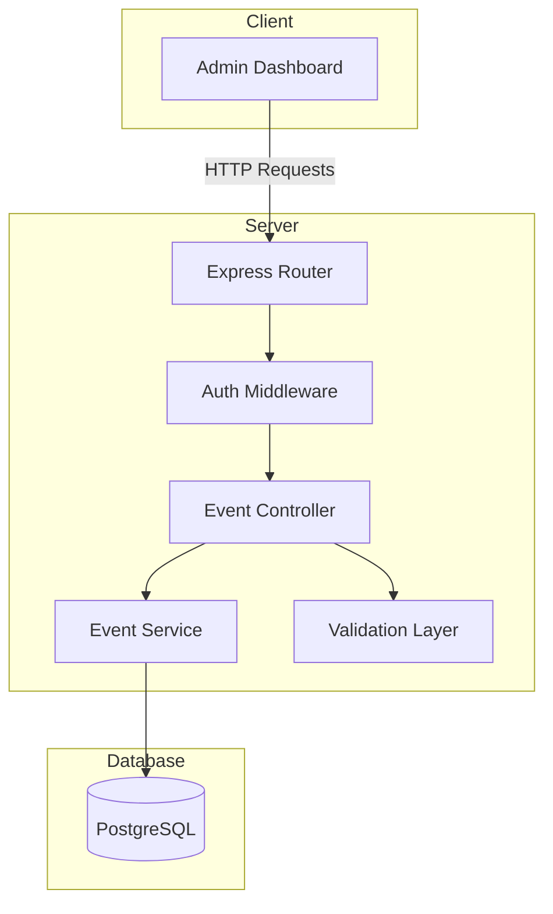

# Design Document: Events Management API

## Overview

The Events Management API provides a RESTful backend for the admin dashboard's event management functionality. It enables administrators to create, read, update, and delete events, manage participant registrations, and retrieve event statistics. The API follows the existing server architecture using Express.js, Prisma ORM, and PostgreSQL.

## Architecture



### Request Flow

1. Client sends HTTP request to Express router
2. Auth middleware validates JWT token and admin role
3. Validation layer validates request body/params using Joi
4. Controller handles request/response logic
5. Service layer contains business logic and database operations
6. Prisma ORM handles database queries

## Components and Interfaces

### API Endpoints

| Method | Endpoint                                            | Description               |
| ------ | --------------------------------------------------- | ------------------------- |
| GET    | `/api/admin/events`                                 | List events with filters  |
| GET    | `/api/admin/events/:id`                             | Get event details         |
| POST   | `/api/admin/events`                                 | Create new event          |
| PUT    | `/api/admin/events/:id`                             | Update event              |
| DELETE | `/api/admin/events/:id`                             | Delete event              |
| GET    | `/api/admin/events/stats`                           | Get event statistics      |
| POST   | `/api/admin/events/:id/participants`                | Add participant           |
| DELETE | `/api/admin/events/:id/participants/:participantId` | Remove participant        |
| PATCH  | `/api/admin/events/:id/participants/:participantId` | Update participant status |

### Event Controller Interface

```typescript
interface EventController {
  getEvents(req: Request, res: Response): Promise<void>;
  getEventById(req: Request, res: Response): Promise<void>;
  createEvent(req: Request, res: Response): Promise<void>;
  updateEvent(req: Request, res: Response): Promise<void>;
  deleteEvent(req: Request, res: Response): Promise<void>;
  getEventStats(req: Request, res: Response): Promise<void>;
  addParticipant(req: Request, res: Response): Promise<void>;
  removeParticipant(req: Request, res: Response): Promise<void>;
  updateParticipantStatus(req: Request, res: Response): Promise<void>;
}
```

### Event Service Interface

```typescript
interface EventService {
  findAll(filters: EventFilters): Promise<PaginatedEvents>;
  findById(id: string): Promise<EventWithParticipants | null>;
  create(data: CreateEventInput): Promise<Event>;
  update(id: string, data: UpdateEventInput): Promise<Event>;
  delete(id: string): Promise<void>;
  getStats(timeRange?: TimeRange): Promise<EventStats>;
  addParticipant(eventId: string, userId: string): Promise<EventParticipant>;
  removeParticipant(eventId: string, participantId: string): Promise<void>;
  updateParticipantStatus(eventId: string, participantId: string, status: ParticipantStatus): Promise<EventParticipant>;
}
```

### Validation Schemas

```typescript
// Event creation validation
const createEventSchema = Joi.object({
  title: Joi.string().required().max(255),
  shortDescription: Joi.string().required().max(500),
  description: Joi.string().required(),
  date: Joi.date().iso().required(),
  time: Joi.string()
    .required()
    .pattern(/^\d{1,2}:\d{2}(AM|PM)$/i),
  category: Joi.string().valid("online", "in-person").required(),
  meetingLink: Joi.string().uri().when("category", {
    is: "online",
    then: Joi.required(),
    otherwise: Joi.optional(),
  }),
  thumbnail: Joi.string().uri().optional(),
});

// Event update validation
const updateEventSchema = Joi.object({
  title: Joi.string().max(255),
  shortDescription: Joi.string().max(500),
  description: Joi.string(),
  date: Joi.date().iso(),
  time: Joi.string().pattern(/^\d{1,2}:\d{2}(AM|PM)$/i),
  category: Joi.string().valid("online", "in-person"),
  meetingLink: Joi.string().uri().allow(null),
  thumbnail: Joi.string().uri().allow(null),
  status: Joi.string().valid("upcoming", "done"),
}).min(1);

// Filter validation
const eventFiltersSchema = Joi.object({
  month: Joi.number().min(1).max(12),
  year: Joi.number().min(2020).max(2100),
  status: Joi.string().valid("upcoming", "done"),
  category: Joi.string().valid("online", "in-person"),
  page: Joi.number().min(1).default(1),
  limit: Joi.number().min(1).max(100).default(50),
});
```

## Data Models

### Prisma Schema Extensions

```prisma
model Event {
  id               String             @id @default(cuid())
  title            String
  shortDescription String             @map("short_description")
  description      String
  date             DateTime
  time             String
  category         EventCategory
  meetingLink      String?            @map("meeting_link")
  thumbnail        String?
  status           EventStatus        @default(UPCOMING)
  createdAt        DateTime           @default(now()) @map("created_at")
  updatedAt        DateTime           @updatedAt @map("updated_at")
  participants     EventParticipant[]

  @@map("events")
}

model EventParticipant {
  id        String            @id @default(cuid())
  eventId   String            @map("event_id")
  userId    String            @map("user_id")
  status    ParticipantStatus @default(PENDING)
  time      String?
  createdAt DateTime          @default(now()) @map("created_at")
  updatedAt DateTime          @updatedAt @map("updated_at")

  event     Event             @relation(fields: [eventId], references: [id], onDelete: Cascade)
  user      User              @relation(fields: [userId], references: [id], onDelete: Cascade)

  @@unique([eventId, userId])
  @@map("event_participants")
}

enum EventCategory {
  ONLINE
  IN_PERSON
}

enum EventStatus {
  UPCOMING
  DONE
}

enum ParticipantStatus {
  SUBSCRIBED
  PENDING
}
```

### TypeScript Types

```typescript
interface Event {
  id: string;
  title: string;
  shortDescription: string;
  description: string;
  date: Date;
  time: string;
  category: "online" | "in-person";
  meetingLink?: string;
  thumbnail?: string;
  status: "upcoming" | "done";
  createdAt: Date;
  updatedAt: Date;
}

interface EventParticipant {
  id: string;
  eventId: string;
  userId: string;
  status: "Subscribed" | "Pending";
  time?: string;
  user: {
    id: string;
    name: string;
    email: string;
  };
}

interface EventWithParticipants extends Event {
  participants: EventParticipant[];
  participantCount: number;
}

interface EventFilters {
  month?: number;
  year?: number;
  status?: "upcoming" | "done";
  category?: "online" | "in-person";
  page: number;
  limit: number;
}

interface PaginatedEvents {
  events: Event[];
  total: number;
  page: number;
  limit: number;
  totalPages: number;
}

interface EventStats {
  totalEvents: number;
  totalRegistrations: number;
  totalAttendants: number;
  eventChange: number;
  registrationChange: number;
  attendantChange: number;
}

interface TimeRange {
  start: Date;
  end: Date;
}
```

## Correctness Properties

_A property is a characteristic or behavior that should hold true across all valid executions of a system-essentially, a formal statement about what the system should do. Properties serve as the bridge between human-readable specifications and machine-verifiable correctness guarantees._

Based on the prework analysis, the following properties have been identified. After reflection, redundant properties have been consolidated:

### Property 1: Event Creation Round Trip

_For any_ valid event input data, creating an event and then retrieving it by ID should return an event with matching field values (excluding auto-generated fields like id, createdAt, updatedAt). **Validates: Requirements 1.1, 1.5**

### Property 2: Online Event Requires Meeting Link

_For any_ event creation request with category "online" and no meeting link, the API should reject the request with a 400 status. **Validates: Requirements 1.3**

### Property 3: In-Person Event Accepts Missing Meeting Link

_For any_ event creation request with category "in-person" and no meeting link, the API should accept the request and create the event successfully. **Validates: Requirements 1.4**

### Property 4: Invalid Event Data Rejection

_For any_ event creation or update request with missing required fields or invalid data types, the API should reject the request with a 400 status and return validation error details. **Validates: Requirements 1.2, 3.4**

### Property 5: Event List Sorted by Date

_For any_ request to list events, the returned events should be sorted by date in ascending order. **Validates: Requirements 2.1**

### Property 6: Month Filter Returns Correct Events

_For any_ set of events and a month/year filter, all returned events should have dates within that calendar month, and no events outside that month should be returned. **Validates: Requirements 2.2**

### Property 7: Status Filter Returns Matching Events

_For any_ set of events and a status filter, all returned events should have the specified status. **Validates: Requirements 2.3**

### Property 8: Category Filter Returns Matching Events

_For any_ set of events and a category filter, all returned events should have the specified category. **Validates: Requirements 2.4**

### Property 9: Event Update Persistence

_For any_ existing event and valid update data, updating the event and then retrieving it should return the updated values. **Validates: Requirements 3.1**

### Property 10: Category Change Validation

_For any_ existing in-person event, updating the category to "online" without providing a meeting link should be rejected with a 400 status. **Validates: Requirements 3.3**

### Property 11: Event Deletion Removes Event

_For any_ existing event, deleting it and then attempting to retrieve it should return a 404 status. **Validates: Requirements 4.1**

### Property 12: Cascade Delete Removes Participants

_For any_ existing event with participants, deleting the event should also remove all associated participant records. **Validates: Requirements 4.3**

### Property 13: Event Details Include Participant Count

_For any_ event with participants, retrieving the event details should include an accurate participant count matching the number of registration records. **Validates: Requirements 5.1, 5.3**

### Property 14: Participant Registration Creates Record

_For any_ valid user and event, adding the user as a participant should create a registration record that can be retrieved. **Validates: Requirements 6.1**

### Property 15: Participant Removal Deletes Record

_For any_ existing participant registration, removing the participant should delete the record so it no longer appears in the event's participant list. **Validates: Requirements 6.2**

### Property 16: Duplicate Participant Rejection

_For any_ user already registered for an event, attempting to register them again should return a 409 conflict status. **Validates: Requirements 6.3**

### Property 17: Participant Status Update Persistence

_For any_ existing participant registration and new status value, updating the status and then retrieving the participant should return the new status. **Validates: Requirements 6.4**

### Property 18: Statistics Accuracy

_For any_ set of events and participants, the statistics endpoint should return counts that match the actual number of records in the database. **Validates: Requirements 7.1**

## Error Handling

### Error Response Format

```typescript
interface ErrorResponse {
  success: false;
  error: {
    code: string;
    message: string;
    details?: Record<string, string[]>;
  };
}
```

### Error Codes

| HTTP Status | Code             | Description                         |
| ----------- | ---------------- | ----------------------------------- |
| 400         | VALIDATION_ERROR | Request validation failed           |
| 401         | UNAUTHORIZED     | Missing or invalid authentication   |
| 403         | FORBIDDEN        | User lacks required permissions     |
| 404         | NOT_FOUND        | Resource not found                  |
| 409         | CONFLICT         | Resource conflict (e.g., duplicate) |
| 500         | INTERNAL_ERROR   | Unexpected server error             |

### Error Handling Strategy

1. **Validation Errors**: Joi validation errors are caught and transformed into structured error responses with field-specific messages
2. **Database Errors**: Prisma errors are caught and mapped to appropriate HTTP status codes
3. **Authentication Errors**: Auth middleware returns 401 for missing/invalid tokens
4. **Authorization Errors**: Auth middleware returns 403 for non-admin users
5. **Not Found Errors**: Service layer throws custom NotFoundError when resources don't exist

## Testing Strategy

### Dual Testing Approach

The testing strategy employs both unit tests and property-based tests to ensure comprehensive coverage:

- **Unit tests** verify specific examples, edge cases, and integration points
- **Property-based tests** verify universal properties that should hold across all valid inputs

### Property-Based Testing Framework

The project will use **fast-check** for property-based testing in TypeScript/JavaScript. Each property test will:

- Run a minimum of 100 iterations
- Be tagged with a comment referencing the correctness property from this design document
- Use the format: `**Feature: events-management-api, Property {number}: {property_text}**`

### Test Categories

1. **Validation Tests**

   - Test Joi schema validation for all input types
   - Verify error messages are descriptive and accurate

2. **Service Layer Tests**

   - Test business logic in isolation
   - Mock Prisma client for database operations

3. **Integration Tests**

   - Test full request/response cycle
   - Use test database with seeded data

4. **Property-Based Tests**
   - Generate random valid/invalid inputs
   - Verify properties hold across all generated cases

### Test File Structure

```
server/
├── __tests__/
│   ├── unit/
│   │   ├── services/
│   │   │   └── event.service.test.ts
│   │   └── validation/
│   │       └── event.validation.test.ts
│   ├── integration/
│   │   └── events.routes.test.ts
│   └── properties/
│       └── event.properties.test.ts
├── __mocks__/
│   └── prisma.ts
└── test-utils/
    ├── generators.ts
    └── setup.ts
```
