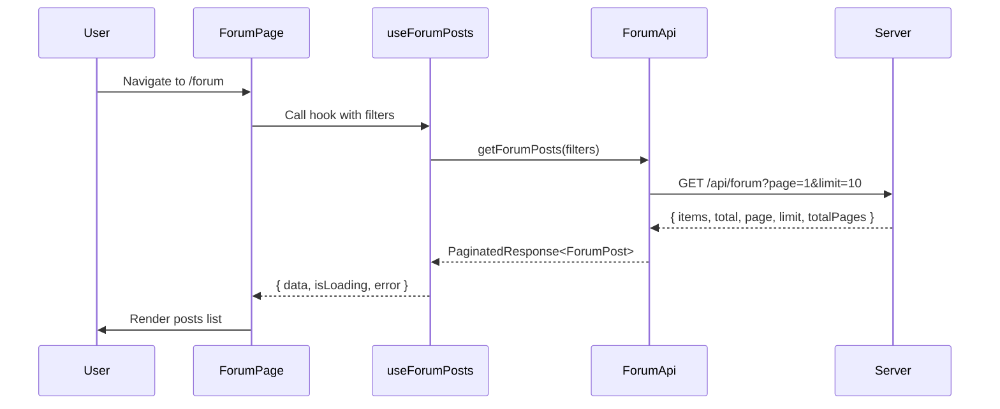
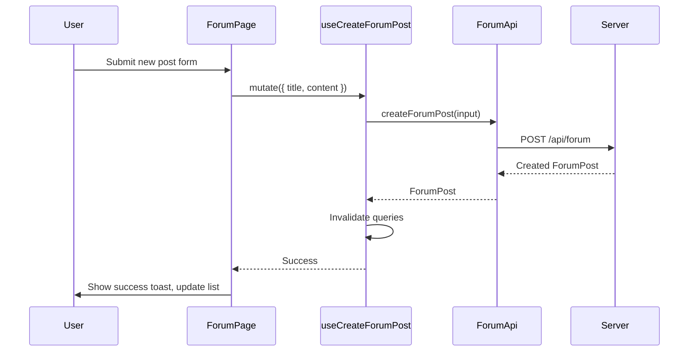

# Design Document

## Overview

This design document outlines the integration of the public-facing forum page with the existing backend API. The implementation will replace the current mock data with real API calls, ensuring proper data synchronization between the client and server.

The forum feature allows subscribed users to:

- Browse and search forum posts
- View individual posts with their replies
- Create new discussion posts
- Reply to existing posts
- Filter posts by various categories

## Architecture

The forum client integration follows a layered architecture:

```
┌─────────────────────────────────────────────────────────────┐
│                    Forum Page Component                      │
│                  (client/app/forum/page.tsx)                │
├─────────────────────────────────────────────────────────────┤
│                    React Query Hooks                         │
│               (client/app/hooks/useForumPosts.ts)           │
├─────────────────────────────────────────────────────────────┤
│                    Forum API Service                         │
│                (client/app/services/forum.ts)               │
├─────────────────────────────────────────────────────────────┤
│                      HTTP Layer                              │
│                    (fetch with credentials)                  │
├─────────────────────────────────────────────────────────────┤
│                    Server API Endpoints                      │
│                   (/api/forum/*)                             │
└─────────────────────────────────────────────────────────────┘
```

## Components and Interfaces

### Forum Service Interface

The forum service will be updated to export a consistent API that matches what the hooks expect:

```typescript
// client/app/services/forum.ts

export interface ForumFilters {
  search?: string;
  page?: number;
  limit?: number;
  authorId?: string;
  isAdmin?: boolean;
}

export interface ForumAuthor {
  id: string;
  name: string | null;
  email: string;
  role?: string;
}

export interface ForumReply {
  id: string;
  postId: string;
  message: string;
  createdAt: string;
}

export interface ForumPost {
  id: string;
  title: string;
  content: string;
  authorId: string;
  author: ForumAuthor;
  starred: boolean;
  replies: ForumReply[];
  createdAt: string;
  updatedAt: string;
}

export interface PaginatedResponse<T> {
  items: T[];
  total: number;
  page: number;
  limit: number;
  totalPages: number;
}

export interface CreateForumPostInput {
  title: string;
  content: string;
}

export const ForumApi = {
  getForumPosts(filters?: ForumFilters): Promise<PaginatedResponse<ForumPost>>;
  getForumPostById(id: string): Promise<ForumPost>;
  createForumPost(input: CreateForumPostInput): Promise<ForumPost>;
  addReply(postId: string, message: string): Promise<ForumReply>;
  toggleStar(id: string): Promise<ForumPost>;
  deleteForumPost(id: string): Promise<void>;
};
```

### Forum Hooks Interface

The hooks will use React Query for data fetching and caching:

```typescript
// client/app/hooks/useForumPosts.ts

export function useForumPosts(filters?: ForumFilters);
export function useForumPost(id: string);
export function useCreateForumPost();
export function useAddForumReply();
export function useToggleForumStar();
export function useDeleteForumPost();
```

### Forum Page State Management

The forum page will manage the following state:

```typescript
interface ForumPageState {
  selectedPostId: string | null;
  searchQuery: string;
  selectedFilter: FilterType;
  isCreateDialogOpen: boolean;
}

type FilterType = "all" | "following" | "trending" | "unanswered" | "announcements" | "my-posts" | "bookmarks";
```

## Data Models

### Post Transformation

The server returns posts in a specific format that needs to be transformed for the UI:

```typescript
// Server response format
interface ServerForumPost {
  id: string;
  title: string;
  content: string;
  authorId: string;
  author: {
    id: string;
    name: string | null;
    email: string;
  };
  starred: boolean;
  replies: ServerForumReply[];
  createdAt: string;
  updatedAt: string;
}

// UI display format
interface UIPost {
  id: string;
  title: string;
  content: string;
  author: {
    name: string;
    email: string;
    avatar: string;
  };
  createdAt: string;
  commentCount: number;
  isNew: boolean;
  isAdmin: boolean;
  participants: string[];
  isBookmarked: boolean;
  isFollowing: boolean;
  comments: UIReply[];
}
```

### Filter Mapping

Client-side filters map to server query parameters:

| Client Filter | Server Query                                       |
| ------------- | -------------------------------------------------- |
| all           | No filter                                          |
| my-posts      | authorId = currentUser.id                          |
| announcements | isAdmin = true (filter client-side by author role) |
| unanswered    | Filter posts with 0 replies                        |

## Data Flow

### Fetching Posts



### Creating a Post



## Correctness Properties

_A property is a characteristic or behavior that should hold true across all valid executions of a system—essentially, a formal statement about what the system should do. Properties serve as the bridge between human-readable specifications and machine-verifiable correctness guarantees._

### Property 1: Post Display Contains Required Fields

_For any_ forum post returned from the API, when rendered in the UI, the output SHALL contain the author name, title, content (or preview), creation time, and reply count.

**Validates: Requirements 1.4**

### Property 2: Replies Display in Chronological Order

_For any_ forum post with multiple replies, when displayed in the UI, the replies SHALL be ordered by creation time in ascending order (oldest first).

**Validates: Requirements 2.2**

### Property 3: Empty Post Validation

_For any_ post submission where the title or content is empty or contains only whitespace characters, the Forum_Page SHALL prevent the submission and not call the API.

**Validates: Requirements 3.3**

### Property 4: Empty Reply Validation

_For any_ reply submission where the content is empty or contains only whitespace characters, the Forum_Page SHALL prevent the submission and not call the API.

**Validates: Requirements 4.3**

### Property 5: Search Results Match Query

_For any_ search query, all returned posts SHALL have the search term present in either the title, content, or author name (case-insensitive match).

**Validates: Requirements 5.1**

### Property 6: My Posts Filter Shows Only User's Posts

_For any_ authenticated user, when the "My Posts" filter is selected, all displayed posts SHALL have an authorId matching the current user's ID.

**Validates: Requirements 6.2**

### Property 7: Announcements Filter Shows Only Admin Posts

_For any_ posts displayed when the "Announcements" filter is selected, all posts SHALL have an author with role "ADMIN".

**Validates: Requirements 6.3**

### Property 8: API Error Handling

_For any_ API request that returns a non-2xx status code, the Forum_Service SHALL throw an Error with a descriptive message.

**Validates: Requirements 7.2**

## Error Handling

### Client-Side Errors

| Error Type                      | Handling Strategy                                                   |
| ------------------------------- | ------------------------------------------------------------------- |
| Network Error                   | Display "Unable to connect. Please check your internet connection." |
| 401 Unauthorized                | Redirect to login page                                              |
| 403 Forbidden (No Subscription) | Display subscription required message with link to pricing          |
| 404 Not Found                   | Display "Post not found" message                                    |
| 500 Server Error                | Display "Something went wrong. Please try again later."             |
| Validation Error                | Display field-specific error messages                               |

### Error Display Components

```typescript
// Error states in the forum page
interface ErrorState {
  type: "network" | "auth" | "subscription" | "notFound" | "server" | "validation";
  message: string;
  details?: Record<string, string[]>;
}
```

### Retry Strategy

- Network errors: Allow manual retry via "Try Again" button
- Server errors: Allow manual retry with exponential backoff suggestion
- Auth errors: No retry, redirect to login
- Validation errors: No retry, fix input and resubmit

## Testing Strategy

### Unit Tests

Unit tests will verify specific examples and edge cases:

1. **Service Layer Tests**

   - Test that `ForumApi.getForumPosts` calls the correct endpoint
   - Test that `ForumApi.createForumPost` sends correct payload
   - Test that `ForumApi.addReply` sends correct payload
   - Test error handling for failed requests

2. **Hook Tests**

   - Test that hooks return correct loading states
   - Test that mutations invalidate correct queries
   - Test error handling in mutations

3. **Component Tests**
   - Test loading indicator display
   - Test error message display
   - Test empty state display
   - Test form validation

### Property-Based Tests

Property-based tests will verify universal properties across many generated inputs:

1. **Property 1**: Generate random posts and verify all required fields are rendered
2. **Property 2**: Generate posts with random replies and verify chronological ordering
3. **Property 3**: Generate various empty/whitespace strings and verify validation
4. **Property 4**: Generate various empty/whitespace strings and verify reply validation
5. **Property 5**: Generate random search queries and verify result matching
6. **Property 6**: Generate random users and posts, verify my-posts filter
7. **Property 7**: Generate random posts with admin/non-admin authors, verify filter
8. **Property 8**: Generate various error responses and verify error throwing

### Testing Framework

- **Unit Tests**: Vitest with React Testing Library
- **Property-Based Tests**: fast-check library for property-based testing
- **Minimum iterations**: 100 per property test

### Test File Structure

```
client/
├── __tests__/
│   ├── services/
│   │   └── forum.test.ts
│   ├── hooks/
│   │   └── useForumPosts.test.ts
│   └── properties/
│       └── forum.properties.test.ts
```
