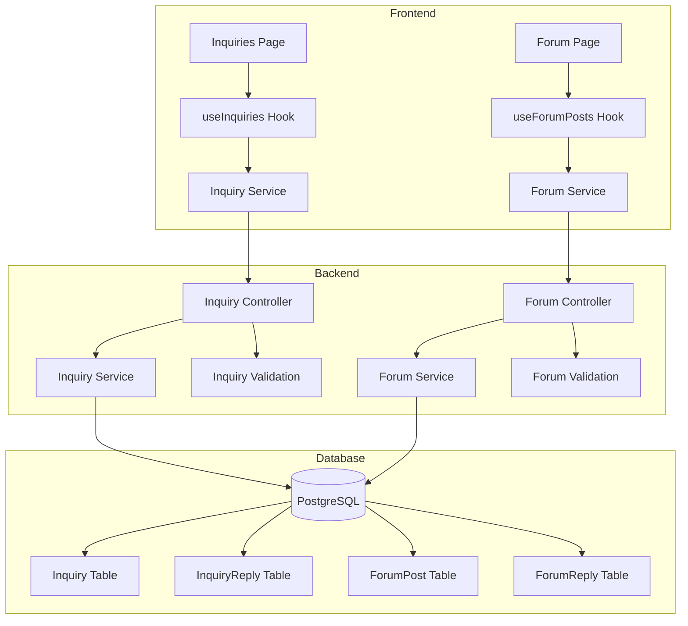

# Design Document: Inquiries and Forum API

## Overview

This design document outlines the backend API and frontend integration for the Inquiries Management and Forum Management features. Both features follow similar patterns but serve different purposes:

- **Inquiries**: Direct support messages from users to admins (one-way communication with admin replies)
- **Forum Posts**: Community discussions created by authenticated users (public content with admin moderation)

The implementation follows the existing patterns established in the codebase using Express.js, Prisma ORM, Joi validation, and React Query on the frontend.

## Architecture



## Components and Interfaces

### Backend Components

#### 1. Inquiry Controller (`server/controllers/inquiry.controller.ts`)

Handles HTTP requests for inquiry management:

- `GET /api/admin/inquiries` - List all inquiries with pagination and search
- `GET /api/admin/inquiries/:id` - Get inquiry details with replies
- `POST /api/inquiries` - Create new inquiry (public endpoint)
- `POST /api/admin/inquiries/:id/replies` - Add admin reply
- `PATCH /api/admin/inquiries/:id/star` - Toggle starred status

#### 2. Forum Controller (`server/controllers/forum.controller.ts`)

Handles HTTP requests for forum management:

- `GET /api/admin/forum` - List all forum posts with pagination and search
- `GET /api/admin/forum/:id` - Get forum post details with replies
- `POST /api/forum` - Create new forum post (authenticated users)
- `POST /api/admin/forum/:id/replies` - Add admin reply
- `PATCH /api/admin/forum/:id/star` - Toggle starred status
- `DELETE /api/admin/forum/:id` - Delete forum post

#### 3. Services

- `InquiryService` - Business logic for inquiry operations
- `ForumService` - Business logic for forum operations

#### 4. Validation Schemas

- `inquiryValidation.ts` - Joi schemas for inquiry endpoints
- `forumValidation.ts` - Joi schemas for forum endpoints

### Frontend Components

#### 1. API Services

- `client/app/services/inquiries.ts` - API client for inquiry endpoints
- `client/app/services/forum.ts` - API client for forum endpoints

#### 2. React Query Hooks

- `client/app/hooks/useInquiries.ts` - Query hooks for inquiries
- `client/app/hooks/useForumPosts.ts` - Query hooks for forum posts

## Data Models

### Prisma Schema Additions

```prisma
model Inquiry {
  id        String         @id @default(cuid())
  name      String
  email     String
  subject   String
  message   String         @db.Text
  starred   Boolean        @default(false)
  createdAt DateTime       @default(now()) @map("created_at")
  updatedAt DateTime       @updatedAt @map("updated_at")
  replies   InquiryReply[]

  @@map("inquiries")
}

model InquiryReply {
  id        String   @id @default(cuid())
  inquiryId String   @map("inquiry_id")
  message   String   @db.Text
  createdAt DateTime @default(now()) @map("created_at")

  inquiry   Inquiry  @relation(fields: [inquiryId], references: [id], onDelete: Cascade)

  @@map("inquiry_replies")
}

model ForumPost {
  id        String       @id @default(cuid())
  authorId  String       @map("author_id")
  title     String
  content   String       @db.Text
  starred   Boolean      @default(false)
  createdAt DateTime     @default(now()) @map("created_at")
  updatedAt DateTime     @updatedAt @map("updated_at")

  author    User         @relation(fields: [authorId], references: [id], onDelete: Cascade)
  replies   ForumReply[]

  @@map("forum_posts")
}

model ForumReply {
  id        String    @id @default(cuid())
  postId    String    @map("post_id")
  message   String    @db.Text
  createdAt DateTime  @default(now()) @map("created_at")

  post      ForumPost @relation(fields: [postId], references: [id], onDelete: Cascade)

  @@map("forum_replies")
}
```

### TypeScript Interfaces

```typescript
// Inquiry Types
interface Inquiry {
  id: string;
  name: string;
  email: string;
  subject: string;
  message: string;
  starred: boolean;
  createdAt: string;
  updatedAt: string;
  replies?: InquiryReply[];
}

interface InquiryReply {
  id: string;
  inquiryId: string;
  message: string;
  createdAt: string;
}

interface CreateInquiryInput {
  name: string;
  email: string;
  subject: string;
  message: string;
}

// Forum Types
interface ForumPost {
  id: string;
  authorId: string;
  title: string;
  content: string;
  starred: boolean;
  createdAt: string;
  updatedAt: string;
  author: {
    id: string;
    name: string | null;
    email: string;
  };
  replies?: ForumReply[];
}

interface ForumReply {
  id: string;
  postId: string;
  message: string;
  createdAt: string;
}

interface CreateForumPostInput {
  title: string;
  content: string;
}

// Shared Types
interface PaginatedResponse<T> {
  items: T[];
  total: number;
  page: number;
  limit: number;
  totalPages: number;
}

interface ListFilters {
  search?: string;
  page?: number;
  limit?: number;
}
```

## Correctness Properties

_A property is a characteristic or behavior that should hold true across all valid executions of a system-essentially, a formal statement about what the system should do. Properties serve as the bridge between human-readable specifications and machine-verifiable correctness guarantees._

### Property 1: List pagination returns items in descending creation order

_For any_ collection of inquiries or forum posts, when fetched via the list endpoint, the items SHALL be sorted by `createdAt` in descending order (newest first). **Validates: Requirements 1.1, 4.1**

### Property 2: Search filters return only matching results

_For any_ search query on inquiries, all returned items SHALL contain the search term in at least one of: name, email, or subject fields. _For any_ search query on forum posts, all returned items SHALL contain the search term in at least one of: author name, title, or content fields. **Validates: Requirements 1.3, 4.3**

### Property 3: Whitespace-only replies are rejected

_For any_ string composed entirely of whitespace characters (spaces, tabs, newlines), submitting it as a reply message SHALL result in a validation error and no reply record being created. **Validates: Requirements 2.3, 5.3**

### Property 4: Star toggle inverts the current state

_For any_ inquiry or forum post, calling the star toggle endpoint SHALL change the `starred` field from `true` to `false` or from `false` to `true`, and the change SHALL persist when the item is fetched again. **Validates: Requirements 3.1, 3.2, 6.1**

### Property 5: Deleted forum posts are not retrievable

_For any_ forum post that has been deleted, subsequent attempts to fetch it by ID SHALL return a 404 error, and it SHALL not appear in list results. **Validates: Requirements 6.2**

### Property 6: Created items return complete data

_For any_ valid inquiry or forum post creation request, the response SHALL contain all submitted fields plus system-generated fields (id, createdAt, updatedAt, starred=false). **Validates: Requirements 7.1, 7.3, 8.1, 8.3**

### Property 7: Missing required fields are rejected

_For any_ inquiry creation request missing name, email, subject, or message, the system SHALL return a validation error. _For any_ forum post creation request missing title or content, the system SHALL return a validation error. **Validates: Requirements 7.2, 8.2**

### Property 8: Replies are associated with correct parent

_For any_ reply created on an inquiry or forum post, fetching the parent item SHALL include that reply in its replies array. **Validates: Requirements 2.1, 5.1**

## Error Handling

### Error Response Format

Following the existing pattern in the codebase:

```typescript
interface ErrorResponse {
  success: false;
  error: {
    code: string;
    message: string;
    details?: Record<string, string[]>;
  };
}
```

### Error Codes

- `VALIDATION_ERROR` - Invalid input data (400)
- `NOT_FOUND` - Resource not found (404)
- `UNAUTHORIZED` - Authentication required (401)
- `INTERNAL_ERROR` - Server error (500)

## Testing Strategy

### Property-Based Testing

The implementation will use **fast-check** for property-based testing in TypeScript/JavaScript. Each correctness property will be implemented as a property-based test.

Configuration:

- Minimum 100 iterations per property test
- Tests will be annotated with the property number and requirements reference

### Unit Tests

Unit tests will cover:

- Validation schema edge cases
- Service method error handling
- Controller response formatting

### Test File Structure

```
server/
  __tests__/
    inquiry.service.test.ts
    inquiry.controller.test.ts
    inquiry.properties.test.ts
    forum.service.test.ts
    forum.controller.test.ts
    forum.properties.test.ts
```

### Property Test Annotation Format

Each property-based test MUST include a comment in this format:

```typescript
// **Feature: inquiries-forum-api, Property 1: List pagination returns items in descending creation order**
// **Validates: Requirements 1.1, 4.1**
```
