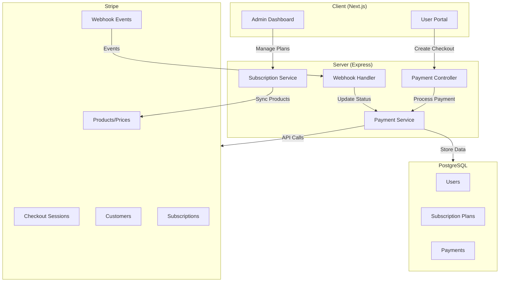

# Design Document: Stripe Payment Gateway

## Overview

This design document outlines the architecture and implementation details for integrating Stripe as the payment gateway for the BizValuer platform. The integration enables secure payment processing for subscription plans, handles webhook events for payment lifecycle management, and provides both user and admin interfaces for payment operations.

The design follows a service-oriented architecture, with a dedicated Stripe service handling all Stripe API interactions, a webhook handler for event processing, and appropriate database schema extensions to track payment and subscription data.

## Architecture



## Components and Interfaces

### 1. Payment Service (`server/services/payment.ts`)

The core service handling all Stripe interactions.

```typescript
interface PaymentService {
  // Customer Management
  getOrCreateStripeCustomer(userId: string): Promise<string>;

  // Checkout Sessions
  createCheckoutSession(params: CreateCheckoutParams): Promise<CheckoutSessionResult>;

  // Subscription Management
  cancelSubscription(userId: string): Promise<void>;
  getSubscriptionStatus(userId: string): Promise<SubscriptionStatus>;

  // Payment History
  getPaymentHistory(userId: string): Promise<Payment[]>;

  // Admin Operations
  grantSubscriptionAccess(userId: string, planId: string, adminId: string): Promise<void>;
  revokeSubscriptionAccess(userId: string, adminId: string): Promise<void>;
}

interface CreateCheckoutParams {
  userId: string;
  planId: string;
  successUrl: string;
  cancelUrl: string;
}

interface CheckoutSessionResult {
  sessionId: string;
  url: string;
}

interface SubscriptionStatus {
  status: "active" | "past_due" | "canceled" | "incomplete" | "none";
  currentPeriodEnd?: Date;
  cancelAtPeriodEnd?: boolean;
}
```

### 2. Webhook Handler (`server/services/webhook.ts`)

Processes incoming Stripe webhook events.

```typescript
interface WebhookHandler {
  handleEvent(payload: Buffer, signature: string): Promise<WebhookResult>;
}

interface WebhookResult {
  success: boolean;
  eventType: string;
  message?: string;
}

// Supported Events
type SupportedWebhookEvent = "checkout.session.completed" | "invoice.payment_succeeded" | "invoice.payment_failed" | "customer.subscription.deleted" | "customer.subscription.updated";
```

### 3. Payment Controller (`server/controllers/payment.controller.ts`)

HTTP endpoints for payment operations.

```typescript
// User Endpoints
POST   /api/payments/checkout          // Create checkout session
GET    /api/payments/history           // Get user's payment history
GET    /api/payments/subscription      // Get subscription status
POST   /api/payments/cancel            // Cancel subscription

// Webhook Endpoint
POST   /api/webhooks/stripe            // Stripe webhook handler

// Admin Endpoints
GET    /api/admin/payments             // List all payments
GET    /api/admin/payments/stats       // Payment statistics
POST   /api/admin/users/:id/grant-subscription    // Grant access
POST   /api/admin/users/:id/revoke-subscription   // Revoke access
```

### 4. Stripe Product Sync Service

Synchronizes subscription plans with Stripe products and prices.

```typescript
interface StripeSyncService {
  createProductAndPrice(plan: SubscriptionPlan): Promise<StripeIds>;
  updateProduct(plan: SubscriptionPlan): Promise<void>;
  archiveProduct(planId: string): Promise<void>;
}

interface StripeIds {
  productId: string;
  priceId: string;
}
```

## Data Models

### Database Schema Extensions

```prisma
// Add to User model
model User {
  // ... existing fields
  stripeCustomerId    String?   @unique @map("stripe_customer_id")
  stripeSubscriptionId String?  @map("stripe_subscription_id")
  subscriptionStatus  SubscriptionStatus @default(NONE)
  currentPeriodEnd    DateTime? @map("current_period_end")
  cancelAtPeriodEnd   Boolean   @default(false) @map("cancel_at_period_end")
}

// Add to SubscriptionPlan model
model SubscriptionPlan {
  // ... existing fields
  stripeProductId String? @unique @map("stripe_product_id")
  stripePriceId   String? @unique @map("stripe_price_id")
}

// New Payment model
model Payment {
  id                String        @id @default(cuid())
  userId            String        @map("user_id")
  planId            String?       @map("plan_id")
  amount            Int           // Amount in cents
  currency          String        @default("usd")
  status            PaymentStatus @default(PENDING)
  stripePaymentId   String?       @unique @map("stripe_payment_id")
  stripeInvoiceId   String?       @map("stripe_invoice_id")
  description       String?
  createdAt         DateTime      @default(now()) @map("created_at")

  user User @relation(fields: [userId], references: [id], onDelete: Cascade)
  plan SubscriptionPlan? @relation(fields: [planId], references: [id])

  @@map("payments")
}

// New AdminAction model for audit logging
model AdminAction {
  id          String   @id @default(cuid())
  adminId     String   @map("admin_id")
  targetUserId String  @map("target_user_id")
  action      String
  details     Json?
  createdAt   DateTime @default(now()) @map("created_at")

  admin User @relation("AdminActions", fields: [adminId], references: [id])
  targetUser User @relation("TargetActions", fields: [targetUserId], references: [id])

  @@map("admin_actions")
}

enum SubscriptionStatus {
  NONE
  ACTIVE
  PAST_DUE
  CANCELED
  INCOMPLETE
}

enum PaymentStatus {
  PENDING
  SUCCEEDED
  FAILED
  REFUNDED
}
```

### TypeScript Interfaces

```typescript
// Payment types
interface Payment {
  id: string;
  userId: string;
  planId: string | null;
  amount: number;
  currency: string;
  status: PaymentStatus;
  stripePaymentId: string | null;
  stripeInvoiceId: string | null;
  description: string | null;
  createdAt: Date;
  plan?: SubscriptionPlan;
}

// Admin stats
interface PaymentStats {
  totalRevenue: number;
  activeSubscriptions: number;
  recentPayments: Payment[];
  revenueByPlan: { planName: string; revenue: number }[];
}

// Checkout request/response
interface CreateCheckoutRequest {
  planId: string;
  successUrl?: string;
  cancelUrl?: string;
}

interface CreateCheckoutResponse {
  sessionId: string;
  url: string;
}
```

## Correctness Properties

_A property is a characteristic or behavior that should hold true across all valid executions of a system—essentially, a formal statement about what the system should do. Properties serve as the bridge between human-readable specifications and machine-verifiable correctness guarantees._

### Property 1: Customer ID Idempotency

_For any_ user, calling `getOrCreateStripeCustomer` multiple times should always return the same Stripe customer ID, and the customer ID should be stored in the user record after the first call.

**Validates: Requirements 1.1, 1.2**

### Property 2: Email Synchronization

_For any_ user with an email address, when a Stripe customer is created or retrieved, the Stripe customer's email should match the user's email in the database.

**Validates: Requirements 1.3**

### Property 3: Checkout Session Metadata Correctness

_For any_ checkout session created for a user and plan, the session metadata should contain the correct `userId` and `planId` values, and the line items should reflect the plan's price.

**Validates: Requirements 2.1, 2.2**

### Property 4: Checkout Mode Selection

_For any_ subscription plan, if the billing period is MONTHLY or YEARLY, the checkout session mode should be "subscription"; if the billing period is ONE_TIME, the mode should be "payment".

**Validates: Requirements 2.3, 2.4**

### Property 5: Webhook Signature Validation

_For any_ incoming webhook request, if the signature does not match the expected signature computed from the payload and signing secret, the request should be rejected with a 400 status and no state changes should occur.

**Validates: Requirements 3.1, 3.6**

### Property 6: Webhook Event State Updates

_For any_ valid webhook event of type `checkout.session.completed`, `invoice.payment_succeeded`, `invoice.payment_failed`, or `customer.subscription.deleted`, processing the event should update the corresponding user's subscription status and/or create a payment record as appropriate.

**Validates: Requirements 3.2, 3.3, 3.4, 3.5, 3.7**

### Property 7: Subscription Status Transitions

_For any_ subscription, the status should transition correctly based on payment events: successful payment → active, failed payment → past_due, cancellation → canceled.

**Validates: Requirements 4.2, 4.3, 4.4**

### Property 8: Payment Record Completeness

_For any_ recorded payment, the record should contain a non-null amount (in cents as an integer), a valid date, and a Stripe payment/invoice ID.

**Validates: Requirements 5.1, 5.3**

### Property 9: Payment History Ordering

_For any_ user's payment history, the payments should be returned in reverse chronological order (most recent first).

**Validates: Requirements 5.2**

### Property 10: Cancellation Preserves Access Until Period End

_For any_ canceled subscription with `cancelAtPeriodEnd` set to true, the user should retain active access until `currentPeriodEnd` is reached, after which access should be revoked.

**Validates: Requirements 6.1, 6.2, 6.3, 6.4**

### Property 11: Admin Stats Completeness

_For any_ admin stats request, the response should contain `totalRevenue`, `activeSubscriptions`, and `recentPayments` fields with valid values.

**Validates: Requirements 7.1**

### Property 12: Admin Action Audit Logging

_For any_ admin action that modifies a user's subscription (grant or revoke), an audit log entry should be created with the admin ID, target user ID, action type, and timestamp.

**Validates: Requirements 7.5**

### Property 13: Stripe Product Sync on Plan Creation

_For any_ subscription plan created with valid data, a corresponding Stripe product and price should be created, and the Stripe IDs should be stored in the plan record.

**Validates: Requirements 8.1, 8.3**

### Property 14: Stripe Price Immutability

_For any_ subscription plan price update, a new Stripe price should be created (rather than modifying the existing one), and the new price ID should be stored in the plan record.

**Validates: Requirements 8.2**

### Property 15: Webhook Idempotency

_For any_ webhook event, processing the same event multiple times (identified by event ID) should result in the same final state as processing it once—no duplicate payments or status changes.

**Validates: Requirements 10.5**

## Error Handling

### Stripe API Errors

```typescript
class StripeError extends Error {
  constructor(message: string, public code: string, public statusCode: number, public stripeError?: Stripe.StripeError) {
    super(message);
    this.name = "StripeError";
  }
}

// Error codes
const STRIPE_ERROR_CODES = {
  CUSTOMER_CREATION_FAILED: "STRIPE_CUSTOMER_CREATION_FAILED",
  CHECKOUT_SESSION_FAILED: "STRIPE_CHECKOUT_SESSION_FAILED",
  SUBSCRIPTION_CANCEL_FAILED: "STRIPE_SUBSCRIPTION_CANCEL_FAILED",
  WEBHOOK_SIGNATURE_INVALID: "STRIPE_WEBHOOK_SIGNATURE_INVALID",
  PRODUCT_SYNC_FAILED: "STRIPE_PRODUCT_SYNC_FAILED",
  PAYMENT_FAILED: "STRIPE_PAYMENT_FAILED",
} as const;
```

### Error Response Format

```typescript
interface ErrorResponse {
  success: false;
  error: {
    code: string;
    message: string;
    details?: Record<string, unknown>;
  };
}

// User-friendly error messages
const USER_ERROR_MESSAGES: Record<string, string> = {
  card_declined: "Your card was declined. Please try a different payment method.",
  insufficient_funds: "Your card has insufficient funds. Please try a different card.",
  expired_card: "Your card has expired. Please use a different card.",
  processing_error: "An error occurred processing your payment. Please try again.",
  default: "Unable to process payment. Please try again or contact support.",
};
```

### Webhook Error Handling

```typescript
// Webhook processing with error logging
async function handleWebhookWithErrorLogging(payload: Buffer, signature: string): Promise<WebhookResult> {
  try {
    const event = stripe.webhooks.constructEvent(payload, signature, webhookSecret);

    return await processEvent(event);
  } catch (error) {
    // Log for manual review
    await logWebhookError({
      error: error instanceof Error ? error.message : "Unknown error",
      payload: payload.toString(),
      timestamp: new Date(),
    });

    throw error;
  }
}
```

## Testing Strategy

### Unit Tests

Unit tests will cover:

- Input validation for checkout requests
- Error message formatting
- Price formatting utilities
- Subscription status determination logic

### Property-Based Tests

Property-based tests using `fast-check` will validate the correctness properties defined above:

1. **Customer ID Idempotency Test**: Generate random users, call getOrCreateStripeCustomer multiple times, verify same ID returned
2. **Checkout Mode Selection Test**: Generate plans with different billing periods, verify correct mode selection
3. **Payment Record Completeness Test**: Generate payment records, verify all required fields present and amounts are integers
4. **Payment History Ordering Test**: Generate multiple payments with random dates, verify reverse chronological order
5. **Webhook Idempotency Test**: Process same event multiple times, verify no duplicate state changes

### Integration Tests

Integration tests will use Stripe's test mode to verify:

- End-to-end checkout flow
- Webhook event processing
- Subscription lifecycle (create, renew, cancel)
- Admin operations

### Test Configuration

```typescript
// vitest.config.ts additions
export default defineConfig({
  test: {
    // ... existing config
    testTimeout: 30000, // Longer timeout for Stripe API calls
    env: {
      STRIPE_SECRET_KEY: "sk_test_...",
      STRIPE_WEBHOOK_SECRET: "whsec_test_...",
    },
  },
});
```

### Property Test Annotations

Each property test will be annotated with:

```typescript
/**
 * Feature: stripe-payment-gateway
 * Property 1: Customer ID Idempotency
 * Validates: Requirements 1.1, 1.2
 */
```
