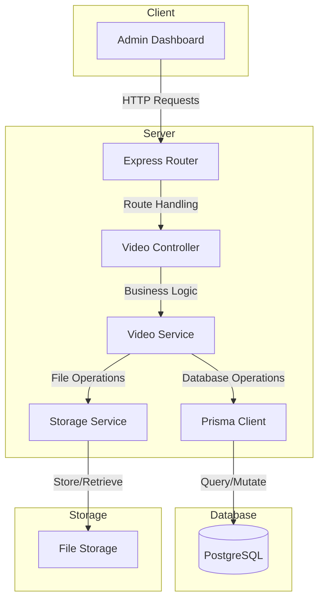

# Design Document: Videos Management API

## Overview

The Videos Management API provides a RESTful backend service for managing video content in the admin dashboard. It follows the same architectural patterns established by the Events Management API, using Express.js with TypeScript, Prisma ORM for database operations, and Joi for request validation.

The API supports full CRUD operations for videos, file uploads for video content and thumbnails, category-based filtering, pagination, and statistics.

## Architecture



### Request Flow

1. Client sends HTTP request to Express router
2. Authentication middleware validates JWT token
3. Admin authorization middleware verifies user role
4. Controller validates request using Joi schemas
5. Service layer executes business logic
6. Prisma handles database operations
7. Storage service manages file uploads
8. Response returned to client

## Components and Interfaces

### Video Routes (`/api/admin/videos`)

| Method | Endpoint            | Description                             |
| ------ | ------------------- | --------------------------------------- |
| GET    | `/`                 | List videos with filters and pagination |
| GET    | `/stats`            | Get video statistics                    |
| GET    | `/:id`              | Get video by ID                         |
| POST   | `/`                 | Create new video                        |
| PUT    | `/:id`              | Update video                            |
| DELETE | `/:id`              | Delete video                            |
| POST   | `/upload`           | Upload video file                       |
| POST   | `/upload/thumbnail` | Upload thumbnail image                  |

### Video Controller

```typescript
interface VideoController {
  getVideos(req: Request, res: Response): Promise<void>;
  getVideoById(req: Request, res: Response): Promise<void>;
  createVideo(req: Request, res: Response): Promise<void>;
  updateVideo(req: Request, res: Response): Promise<void>;
  deleteVideo(req: Request, res: Response): Promise<void>;
  getVideoStats(req: Request, res: Response): Promise<void>;
  uploadVideo(req: Request, res: Response): Promise<void>;
  uploadThumbnail(req: Request, res: Response): Promise<void>;
}
```

### Video Service

```typescript
interface VideoService {
  create(data: CreateVideoInput): Promise<Video>;
  findAll(filters: VideoFilters): Promise<PaginatedVideos>;
  findById(id: string): Promise<Video>;
  update(id: string, data: UpdateVideoInput): Promise<Video>;
  delete(id: string): Promise<void>;
  getStats(): Promise<VideoStats>;
}
```

### Storage Service Extension

```typescript
interface StorageService {
  uploadVideo(file: Express.Multer.File): Promise<string>;
  uploadThumbnail(file: Express.Multer.File): Promise<string>;
  deleteFile(url: string): Promise<void>;
}
```

## Data Models

### Prisma Schema Addition

```prisma
model Video {
  id          String        @id @default(cuid())
  title       String
  description String
  category    VideoCategory
  videoUrl    String        @map("video_url")
  thumbnail   String?
  createdAt   DateTime      @default(now()) @map("created_at")
  updatedAt   DateTime      @updatedAt @map("updated_at")

  @@map("videos")
}

enum VideoCategory {
  TRAINING
  EDUCATIONAL
}
```

### TypeScript Interfaces

```typescript
interface CreateVideoInput {
  title: string;
  description: string;
  category: "training" | "educational";
  videoUrl: string;
  thumbnail?: string | null;
}

interface UpdateVideoInput {
  title?: string;
  description?: string;
  category?: "training" | "educational";
  videoUrl?: string;
  thumbnail?: string | null;
}

interface VideoFilters {
  category?: "training" | "educational";
  page: number;
  limit: number;
}

interface PaginatedVideos {
  videos: Video[];
  total: number;
  page: number;
  limit: number;
  totalPages: number;
}

interface VideoStats {
  totalVideos: number;
  trainingCount: number;
  educationalCount: number;
}
```

### API Response Format

```typescript
// Success response
interface SuccessResponse<T> {
  success: true;
  data: T;
  message?: string;
}

// Error response
interface ErrorResponse {
  success: false;
  error: {
    code: string;
    message: string;
    details?: Record<string, string[]>;
  };
}
```

## Correctness Properties

_A property is a characteristic or behavior that should hold true across all valid executions of a system-essentially, a formal statement about what the system should do. Properties serve as the bridge between human-readable specifications and machine-verifiable correctness guarantees._

Based on the prework analysis, the following correctness properties have been identified:

### Property 1: Video Creation Round-Trip

_For any_ valid video input data, creating a video and then retrieving it by ID should return a video with equivalent title, description, category, and videoUrl fields.

**Validates: Requirements 1.1, 3.1**

### Property 2: Validation Rejects Invalid Input

_For any_ video creation or update request with missing required fields (title, description, category, videoUrl for creation), the system should return a validation error and not modify the database.

**Validates: Requirements 1.2, 4.3**

### Property 3: Category Filter Correctness

_For any_ list request with a category filter, all returned videos should have a category matching the filter value.

**Validates: Requirements 2.2**

### Property 4: Pagination Consistency

_For any_ collection of N videos and a page size of L, requesting page P should return at most L videos, and the total pages should equal ceil(N/L).

**Validates: Requirements 2.3**

### Property 5: Update Persistence

_For any_ existing video and valid update data, after updating, retrieving the video should reflect the updated values.

**Validates: Requirements 4.1**

### Property 6: Deletion Completeness

_For any_ existing video, after deletion, attempting to retrieve the video by ID should return a not found error.

**Validates: Requirements 5.1**

### Property 7: File Upload Returns Valid URL

_For any_ valid video or thumbnail file upload, the system should return a non-empty URL string that can be used to reference the file.

**Validates: Requirements 6.1, 6.4**

### Property 8: Statistics Accuracy

_For any_ set of videos in the database, the statistics endpoint should return a total count equal to the sum of training and educational counts, and each category count should match the actual number of videos with that category.

**Validates: Requirements 7.1, 7.2**

## Error Handling

### Error Types

| Error Code             | HTTP Status | Description                       |
| ---------------------- | ----------- | --------------------------------- |
| VALIDATION_ERROR       | 400         | Invalid request data              |
| UNAUTHORIZED           | 401         | Missing or invalid authentication |
| FORBIDDEN              | 403         | Insufficient permissions          |
| NOT_FOUND              | 404         | Resource not found                |
| FILE_TOO_LARGE         | 413         | Uploaded file exceeds size limit  |
| UNSUPPORTED_MEDIA_TYPE | 415         | Invalid file format               |
| INTERNAL_ERROR         | 500         | Server error                      |

### Validation Rules

**Video Creation:**

- `title`: Required, string, 1-200 characters
- `description`: Required, string, 1-5000 characters
- `category`: Required, enum ("training" | "educational")
- `videoUrl`: Required, valid URL string
- `thumbnail`: Optional, valid URL string or null

**Video Update:**

- All fields optional but must be valid if provided
- At least one field must be provided

**File Upload:**

- Video: Max 100MB, formats: MP4, WebM, OGG, MOV
- Thumbnail: Max 5MB, formats: JPEG, PNG, WebP

**Pagination:**

- `page`: Optional, integer >= 1, default 1
- `limit`: Optional, integer 1-100, default 10

## Testing Strategy

### Property-Based Testing

The project will use **fast-check** as the property-based testing library for TypeScript/JavaScript.

Each correctness property will be implemented as a property-based test with:

- Minimum 100 iterations per property
- Comment annotation linking to the design document property
- Format: `**Feature: videos-management-api, Property {number}: {property_text}**`

### Unit Testing

Unit tests will cover:

- Controller request/response handling
- Service method edge cases
- Validation schema behavior
- Error handling paths

### Test Organization

```
server/
├── __tests__/
│   ├── video.controller.test.ts
│   ├── video.service.test.ts
│   ├── video.validation.test.ts
│   └── video.properties.test.ts  # Property-based tests
```

### Test Database

Tests will use a separate test database or in-memory database to ensure isolation and repeatability.
